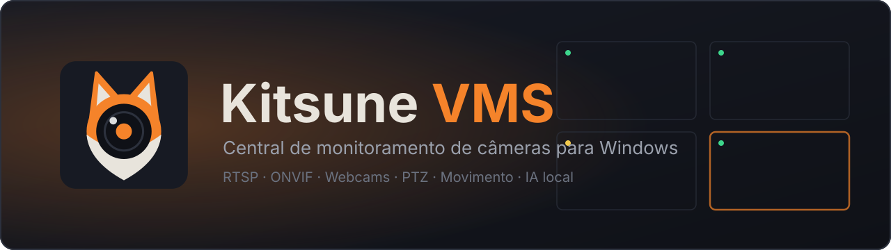
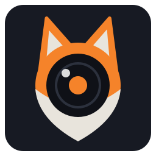

  

  

  
  
  
  
  

  <b>Todas as suas câmeras em uma única janela. Sem conta, sem assinatura e sem enviar nenhuma imagem para a internet.</b>

---

## O que é

O **Kitsune VMS** (*Video Management System*) reúne em um mosaico as câmeras IP e webcams da sua casa, loja ou escritório. Você vê tudo ao vivo, controla as câmeras que giram e é avisado quando algo se mexe — inclusive dizendo **o que** se mexeu: uma pessoa, um veículo ou um animal.

Tudo roda no seu computador: câmeras, senhas, configurações e o modelo de IA ficam apenas com você.

## ✨ Principais funcionalidades

|   |   |
|---|---|
| 🖥️ **Mosaico flexível** Arraste, redimensione e reorganize as células. Salve layouts e organize câmeras em grupos. | 🎥 **Qualquer câmera** RTSP, ONVIF (perfis descobertos sozinhos) e webcams USB, por TCP, UDP ou HTTP. |
| 🕹️ **PTZ completo** Giro, inclinação e zoom, presets e favoritos, zoom digital quando falta o óptico. | 🚨 **Movimento inteligente** Por análise do vídeo, pelos **eventos da própria câmera (ONVIF)** — quase sem CPU — ou por ambos. |
| 🧠 **IA local** Reconhece pessoas, veículos e animais com YOLOX, acelerado pela GPU, sem nuvem. | 🔔 **Alertas sob medida** Notificação do Windows, som, intervalo entre alertas e **horário silencioso**. |
| ⚡ **Leve** Sub-stream na grade, decodificação por GPU e pausa de renderização com a janela minimizada. | 🔒 **Privado e seguro** Senhas protegidas pelo Windows (DPAPI), logs sem credenciais, zero telemetria. |
| 🔄 **Atualiza sozinho** Instalador simples e atualizações automáticas e incrementais. | 🛡️ **Resiliente** Reconexão automática, detecção de imagem travada e gravação atômica das configurações. |

## 📺 Visualização

- **Mosaico configurável** com arrastar e soltar, redimensionamento e **otimização automática** do layout.
- **Visão individual** em um clique (inclusive pela lista lateral), com zoom e arrasto da imagem.
- **Layouts salvos**: guarde disposições diferentes, como "Externas" ou "Dia a dia".
- **Grupos de câmeras** com divisores visuais.
- **Sub-stream na grade**: usa o fluxo leve de cada câmera no mosaico e o principal na visão individual, reduzindo bastante o uso de CPU e memória.
- **Informações do fluxo** (resolução, quadros por segundo, codificação) e indicadores de estado e qualidade.
- **Capturas de imagem** com um clique.

## 🎥 Câmeras

- **RTSP**, **ONVIF** e **webcams** USB.
- **Transporte do vídeo** à escolha: TCP, UDP ou HTTP.
- **Substituição de porta** para ONVIF e RTSP, útil com redirecionamento de portas.
- **Decodificação por hardware** (GPU) opcional.

## 🕹️ PTZ

- Controle contínuo por botões, com **velocidade do passo ajustável** por câmera.
- **Posições predefinidas** (presets) e favoritos de acesso rápido.
- **Zoom digital** quando a câmera não tem zoom óptico, ou **forçar o zoom ONVIF** quando ela o anuncia.
- Inversão de eixos para câmeras com sentido espelhado.
- Comandos com **tempo limite**: se a rede falhar no meio de um movimento, a câmera para sozinha.

## 🚨 Movimento e IA

| Origem do movimento | Como funciona | Custo |
|---|---|---|
| **Pixels** | Compara os quadros do vídeo, com sensibilidade ajustável e filtro de ruído. | Médio |
| **ONVIF** | Usa os avisos de movimento da própria câmera (PullPoint). Reconecta sozinho. | Quase nulo |
| **Ambos** | Dispara com qualquer um dos dois. | Médio |

- Caixa de destaque sobre o vídeo onde há movimento.
- **Reconhecimento de objetos** (pessoas, veículos, animais ou qualquer objeto) com **YOLOX-S**, executado localmente com ONNX Runtime e aceleração por GPU (DirectML).
- A IA só trabalha quando há movimento, para economizar processamento.
- **Ignora objetos parados**: um carro estacionado não gera alertas repetidos.

## 🔔 Alertas

- **Notificação do Windows**, indicador na barra lateral e **borda de destaque** na célula da câmera.
- **Alerta sonoro** com sons embutidos ou um arquivo seu.
- **Intervalo mínimo entre alertas** configurável e **horário silencioso** (sem som nem notificação, mantendo o indicador visual).

## 🔒 Privacidade e segurança

- **Nada sai do seu computador**: sem telemetria, contas ou nuvem.
- **Senhas protegidas com DPAPI** do Windows: só o seu usuário, neste computador, consegue lê-las.
- Mensagens de erro e logs **sem credenciais**: usuários e senhas em URLs são ocultados.
- Configurações salvas de forma **atômica**: um desligamento no meio do salvamento não as corrompe.

## 📦 Instalação

1. Baixe o **`KitsuneVMS-win-Setup.exe`** na página de [**Releases**](../../releases/latest).
2. Execute o instalador. Não precisa de administrador.
3. O aplicativo **se atualiza sozinho** (*Configurações → Sobre*).

**Requisitos:** Windows 10 (2004 ou superior) ou Windows 11, 64 bits. Para a IA acelerada, uma GPU com DirectX 12 (sem ela, roda na CPU, mais devagar).

> [!WARNING]
> **O aplicativo ainda não possui assinatura digital.** O SmartScreen pode exibir *"O Windows protegeu seu computador"*: clique em **Mais informações → Executar assim mesmo**.
> Com o **Smart App Control** ativo, o Windows bloqueia programas não assinados sem opção de continuar. Nesse caso é preciso desativá-lo em *Segurança do Windows → Controle de aplicativos e navegador*.

## 📄 Licença

Distribuído sob a licença [MIT](LICENSE). Os componentes de terceiros e suas licenças estão em [THIRD-PARTY-NOTICES.md](THIRD-PARTY-NOTICES.md).

---

   
  Feito por <b>Kevin Raian</b>

